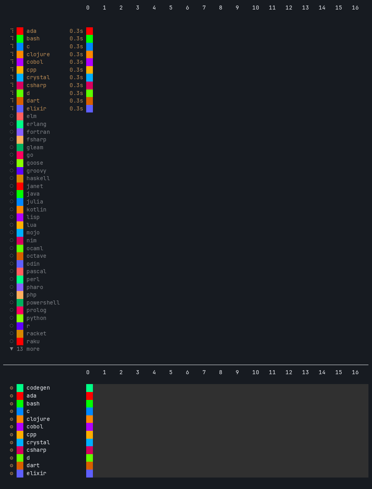

<h1 align="center">
  <picture>
    <source media="(prefers-color-scheme: dark)" srcset="assets/logo/hero-dark.svg">
    
  </picture>
</h1>

<p align="center"><strong>A universal adaptor for programming languages in the age of AI.</strong></p>

<div align="center">

| CI | Release | Languages | License |
| :-: | :-: | :-: | :-: |
| [](https://github.com/dnf/hecatron/actions/workflows/ci.yml) | [](https://github.com/dnf/hecatron/releases) | [](docs/coverage.md) <!-- language-count --> | [](LICENSE.md) |

</div>

Hecatron is an adaptor between you and the toolchains of 54 languages. <!-- language-count -->
`hct test`, `hct lint`, `hct build`, `hct format`, `hct deps` and `hct audit`
do the same thing in an Elixir library, a Go service or a Haskell compiler;
hecatron installs and repairs the toolchain at the version the project asks
for, then calls the language's own tools. It works with no setup step in any git
repository, and is written to be driven by AI coding agents as much as by
people.

The same commands scale from one language to fifty: in a repository where
one project is implemented in many languages, `hct test` runs every
language's tests in parallel, and hecatron keeps the CI workflows and
Dockerfile that cover them in sync.

<p align="center">
  
  <br><em><code>hct test</code> on <a href="https://github.com/dnf/sayable">sayable</a>: 51 languages and its own checks in parallel, 4½ minutes at 5× speed (<a href="docs/runner.md">how the runner works</a>).</em>
</p>

## Why

**Every language's toolchain is different.** Installing it, choosing its
version, and knowing whether its tests run with `cargo test`, `mix test`,
`./gradlew test` or `uv run pytest` is knowledge each repository makes you
learn again. That cost lands hardest on whoever moves between repositories:
a contributor fixing something in a language they don't use daily, a CI
setup shared across many projects, and above all an AI coding agent, which
otherwise spends its first minutes, and its tokens, working out how to run
the tests.

**One interface removes it.** With hecatron the commands are the same in
every repository, the toolchain is installed and checked for you, and an
agent learns the interface once (`hct help agents`).

**And it makes many languages practical.** AI agents make writing and
maintaining an implementation in another language cheap, so one person can
ship the same library natively in a dozen or fifty languages, best kept in
one repository where a fix lands everywhere in one pull request
([more](docs/why-one-repository.md)). What's left is the infrastructure, a
toolchain, commands, CI jobs and Dockerfile lines per language, and with
fifty languages keeping that working becomes the job. Hecatron does that
job: it grew up inside [sayable](https://github.com/dnf/sayable), a set of
formatting libraries in 51 languages.

## Install

Hecatron runs on the bash and Python 3 that current macOS and Linux ship (bash
3.2 or later, Python 3.9 or later).

```bash
curl -fsSL https://raw.githubusercontent.com/dnf/hecatron/main/install.sh | sh
```

This installs anything hecatron itself needs that's missing (the Command Line
Tools on macOS; git, Python 3 and perl on Linux), then the latest release
into `~/.hecatron`, and adds it to your shell's startup files (bash, zsh and
fish), so new shells have `hct`. It prints the one line that puts it on PATH
in the current shell. Run it again to update. From a clone instead, source the installer, which also sets up the
shell you're in:

```bash
git clone https://github.com/dnf/hecatron ~/.hecatron && . ~/.hecatron/install.sh
```

## Quick start

```bash
cd your-repo
hct status        # each language, its toolchain, its last runs and changes
hct doctor --fix  # installs and repairs every language's toolchain
hct test          # every language's tests, in parallel
hct test go       # one language
```

There's no setup step: in a git repository, hecatron detects each language
and where its code lives, and remembers it inside `.git/` until the tracked
files change, writing nothing else. `hct init` saves that as
`.hecatron/config.json`, to commit and adjust. `hct` is short for
`hecatron`. `hct help` lists every command, and `hct <command> help` its
options.

## What it does

- **Toolchains that keep working.** `hct doctor` checks that every language's
  toolchain is installed and actually works; `--fix` runs its installer,
  which is idempotent and repairs the broken states the doctor finds (a
  linter built with an older compiler, a moved virtualenv, an unlinked
  Homebrew formula).
- **The right version for each component.** For Python, Go, Rust, Node.js and
  Java, a pinned default, or the version a component asks for in its
  ecosystem's own file (`.python-version`, `go.mod`, `rust-toolchain.toml`,
  `.nvmrc`, `.java-version`, `.tool-versions`, `mise.toml`...). Versions are
  installed side by side, and each component runs with its own.
- **No hook files for conventional projects.** Default test, lint, build and
  clean commands for all 54 languages, chosen from the build files present <!-- language-count -->
  (`pom.xml` → Maven, `Cargo.toml` → Cargo, `CMakeLists.txt` → CMake and
  CTest...). A project overrides any of them with its own script.
- **Everything at once.** `hct test`, `lint`, `build` and `clean` run every
  language in parallel with a live display and a log per language.
- **Known vulnerabilities, per ecosystem.** `hct audit` runs each language's
  own dependency auditor (`npm audit`, pip-audit, govulncheck, `composer
  audit`, `dotnet list package --vulnerable`, bundler-audit, OSV-Scanner for
  the rest) and fails at a severity you choose, with accepted risks that
  expire ([docs/audit.md](docs/audit.md)).
- **Dependencies, held to the lock file.** `hct deps` fetches every
  component's dependencies with its ecosystem's tool (`npm ci`, `uv sync
  --locked`, `bundle install` frozen, `composer install`, `dotnet restore
  --locked-mode`, `cargo fetch --locked`, `go mod download`, `pub get
  --enforce-lockfile`, `mix deps.get`...), so CI can fetch once and fail on
  a lock file that's out of date. Tests and builds still fetch what's
  missing themselves, the same way.
- **What's out of date.** `hct outdated` lists every component's direct
  dependencies with a newer release, from each ecosystem's own report
  (`npm outdated`, `uv tree --outdated`, `go list -u -m`, Cargo, `bundle
  outdated`, `composer outdated`, `dotnet list package --outdated`, Hex,
  pub, Maven's versions plugin), as a table or `--json`; `--fail` makes it
  a CI check ([docs/outdated.md](docs/outdated.md)).
- **Every dependency's license.** `hct licenses` lists each component's
  dependencies with their SPDX licenses, rolled up per license, unknown ones
  apart, from the lock files (OSV-Scanner and deps.dev; Composer's lock
  file); a policy in the config (allow, deny, accepted packages that
  expire) makes it a CI check ([docs/licenses.md](docs/licenses.md)).
- **One formatter per language.** `hct format` rewrites each component's
  code with its language's formatter and the project's own configuration
  (gofmt, rustfmt, Ruff, `dotnet format`, `mix format`, `dart format`, and
  the Prettier, RuboCop or Spotless a project already uses); `--check`
  changes nothing and lists what it would, and `hct lint` runs that check
  ([docs/format.md](docs/format.md)).
- **Each ecosystem's good practice.** `hct advisor` reads the project and
  recommends what each language's ecosystem asks for: lock files committed
  (and still matching their manifests), toolchains pinned and not past end
  of life, a formatter and linter configured, CI running every language,
  Gradle's caches, GitHub Actions not pinned to a branch. Each finding says
  why and links to the ecosystem's own documentation; it reads files only,
  and `--fix` makes the safe changes, such as a pin file at the version in
  use ([docs/advisor.md](docs/advisor.md)).
- **Generated CI and Dockerfile.** `hct workflows` writes one CI workflow per
  language and `hct dockerfile` an image with every toolchain (and, for the
  languages with versions, each version the components use); `hct check`
  fails when either falls behind.
- **Finds your layout.** `hct init` recognises the directory names real
  projects use (`dotnet/` for C#, `javascript/`, `lib/py`...) and skips
  examples, tests and vendored code.

Hecatron calls each language's own tools (`cargo`, `go`, `gradle`, `uv`...).
It doesn't build anything itself, and it doesn't know what your code does.

## Tested

- **Every language, every week,** on fresh Ubuntu 24.04, Ubuntu 26.04 and
  Debian 13 machines (x86_64 and arm64) and on macOS (Apple Silicon and
  Intel): install, doctor and reinstall, then a smoke test that builds and
  runs a small program with the new toolchain.
  [docs/coverage.md](docs/coverage.md) has the matrix.
- **Real projects.** [sayable](https://github.com/dnf/sayable) runs all 51 of
  its languages through hecatron. On a fresh machine,
  [cucumber/tag-expressions](https://github.com/cucumber/tag-expressions)
  (9 languages) and
  [cucumber/cucumber-expressions](https://github.com/cucumber/cucumber-expressions)
  (8) pass every language's own test suite with `hct init`, `hct install`
  and `hct test`, and no configuration.

## Hecatron or ad hoc?

For a library in ten languages ([full comparison](docs/hecatron-vs-ad-hoc.md)):

| Ad hoc | With hecatron |
| --- | --- |
| Setup docs for 10 toolchains × 2 OSes | `hct doctor --fix` |
| 10 test commands to remember | `hct test`, all in parallel |
| CI and Dockerfile kept in sync by hand | `hct workflows`, `hct dockerfile`<br>`hct check` catches drift |
| Each project fixes toolchain rot itself | Fixed once, tested on every supported distribution |

## Built for AI agents

- **No setup step.** In any git repository, hecatron detects the languages
  and layout and remembers them inside `.git/`; nothing is written to the
  working tree until you run `hct init`.
- **A skill to load.** The hecatron Agent Skill teaches an agent the whole
  interface without reading the docs: in Claude Code,
  `/plugin install hecatron --marketplace dnf/hecatron`, or `hct skill
  install` (`--project` puts it in the repository, for everyone who opens
  it); other agents that read Agent Skills take it with `hct skill install
  --dir <their skills folder>`; in claude.ai,
  upload a release's `hecatron-skill.zip` under Settings > Features.
- **Output sized for agents.** With `HECATRON_OUTPUT=agent`, a run prints
  one summary line, then only the failures with their log paths and key
  error lines, under a third of the human summary; exit status 3 means a
  toolchain is missing.
- **One reference to learn.** `hct help agents` prints [a compact
  reference](docs/agents.md) written for agents, matching the installed
  version; [llms.txt](llms.txt) points web-reading tools to it.
- **Instructions where agents look.** `hct init` adds a short section to
  `AGENTS.md` (and has an existing `CLAUDE.md` load it), so an agent knows
  how to build and test the repository from its first message.
- **Safe by default.** Commands that change the machine (`install`,
  `doctor --fix`) are separate from those that only run the project's
  tools, and the agent reference says to ask before the former.

Coming next: running only what a change touched
([#91](https://github.com/dnf/hecatron/issues/91)), and catching up after a
pull ([#92](https://github.com/dnf/hecatron/issues/92)).

## From one language to fifty

In a single-language repository, hecatron is the adaptor: whether the
repository is Elixir, Haskell, Zig or Kotlin, the same commands set it up
and run it.

```bash
hct install    # the toolchain, at the version the project asks for
hct test       # mix test, stack test, zig build test, gradle test...
hct lint       # the language's linter and formatter check
```

In a repository with many languages, the same commands run every language
at once, with a live display and a log per language, and hecatron also
generates and checks the CI workflows and Dockerfile. In both, it picks each
toolchain's version from the project's own files, gives an old checkout the
toolchain of its day, and runs each ecosystem's own dependency auditor.

## Compared with other tools

| Tool | What it does | Next to hecatron |
| --- | --- | --- |
| [mise](https://mise.jdx.dev), [asdf](https://asdf-vm.com) | Install and switch tool versions | Hecatron also installs versions, and reads `.tool-versions` and `mise.toml`, but its job is the whole loop: repairing toolchains, running every language's tests and lints, and generating CI |
| [Nx](https://nx.dev), [Bazel](https://bazel.build), [moon](https://moonrepo.dev), [Pants](https://www.pantsbuild.org) | A build graph across the repository: dependencies between targets, caching, building only what changed | Hecatron has no build graph or cache; it runs each language's own build tool. It fits one library implemented separately per language; a repository whose parts depend on each other across languages is those tools' ground |
| [devbox](https://www.jetify.com/devbox), [Nix](https://nixos.org) | Reproducible environments from Nix packages | Hecatron uses each ecosystem's own installers (official releases, rustup, uv, apt, Homebrew) and checks that they work, without Nix |

## Configuring a project

`hct init` writes `.hecatron/config.json`, committed with the code:

```json
{
  "schema": 1,
  "project": "sayable",
  "components": ["age", "date", "duration", "time"],
  "implPath": "{component}/impl/{lang}",
  "languages": ["go", "python", "rust", "typescript"]
}
```

A project can override any default hook with its own
`.hecatron/languages/<lang>/test.sh` (or `lint.sh`, `build.sh`, `clean.sh`),
run once per component from that component's directory for the language. It
can also override any file of a built-in language definition there, or define
a language hecatron doesn't know. [docs/design.md](docs/design.md) describes
the full configuration.

## Languages

Hecatron ships definitions for 54 languages: <!-- language-count -->

Ada, Bash, C, C++, C#, Clojure, COBOL, Common Lisp, Crystal, D, Dart, Elixir,
Elm, Erlang, F#, Fortran, Gleam, Go, Goose, Groovy, Haskell, Haxe, Janet,
Java, JavaScript, Julia, Kotlin, Lua, Mojo, Nim, Objective-C, OCaml, Octave,
Odin, Pascal, Perl, Pharo, PHP, PowerShell, Prolog, Python, R, Racket, Raku,
Ruby, Rust, Scala, Swift, Tcl, TypeScript, V, VB.NET, Wren and Zig.

[docs/languages.md](docs/languages.md) has each one with a link to its home,
what it's for, and the build systems, test runners and linters hecatron uses
for it; it's also a good place to discover a language you haven't tried.
Adding another is a directory of small scripts; see
[docs/adding-a-language.md](docs/adding-a-language.md).

## Status

Hecatron is young: version 0.5. It works and runs sayable's checks, but
expect changes before 1.0. Changes are listed in
[CHANGELOG.md](CHANGELOG.md).

- **Platforms:** macOS (Apple Silicon and Intel) and Linux (Debian and
  Ubuntu, x86_64 and arm64).
- **Next:** a single fast binary written in Go, with native Windows support
  ([design](docs/design.md#19-a-go-core-and-native-windows),
  [#80](https://github.com/dnf/hecatron/issues/80)); and for CI, a GitHub
  Action, GitLab CI generation, and results every forge shows (JUnit, SARIF,
  job summaries; [source control backends](docs/design.md#20-source-control-backends)).

## Documentation

| Document | Contents |
| --- | --- |
| [docs/runner.md](docs/runner.md) | How `hct test` and friends run every language at once: concurrency, scheduling, the live display |
| [docs/agents.md](docs/agents.md) | The compact reference for AI coding agents (`hct help agents`) |
| [docs/why-one-repository.md](docs/why-one-repository.md) | Why one library in many languages belongs in one repository |
| [docs/design.md](docs/design.md) | How hecatron works and why: concepts, configuration, commands, and the decisions behind them |
| [docs/languages.md](docs/languages.md) | Every language: its home, what it's for, and how hecatron builds, tests and lints it |
| [docs/coverage.md](docs/coverage.md) | Which languages install and work on which platforms |
| [docs/audit.md](docs/audit.md) | `hct audit`: each language's dependency auditor, severities, accepted risks, CI |
| [docs/outdated.md](docs/outdated.md) | `hct outdated`: each language's report of newer dependency versions, `--json`, `--fail` |
| [docs/format.md](docs/format.md) | `hct format`: each language's formatter, `--check`, and the format check in `hct lint` |
| [docs/hecatron-vs-ad-hoc.md](docs/hecatron-vs-ad-hoc.md) | A ten-language library maintained with hecatron and without it |
| [docs/installers.md](docs/installers.md) | How each language's toolchain is installed on macOS and Linux, and toolchains languages share |
| [docs/adding-a-language.md](docs/adding-a-language.md) | Writing a language definition |
| [docs/build-conventions.md](docs/build-conventions.md) | Where each language's build artifacts go |
| [libexec/runner/README.md](libexec/runner/README.md) | The parallel runner and its live display |

## Getting help

Questions, bugs and ideas go to
[GitHub issues](https://github.com/dnf/hecatron/issues). For a security
problem, see [SECURITY.md](SECURITY.md).

## Contributing

Issues and pull requests are welcome. [CONTRIBUTING.md](CONTRIBUTING.md) has
the checks to run (`hct self-test`), the conventions the code follows, and a
map of the repository.

## Acknowledgements

- [Dave Sifry](https://github.com/dsifry), for
  [metaswarm](https://github.com/dsifry/metaswarm), his open-source framework
  for running teams of AI coding agents through a whole development
  lifecycle.
- The wordmark is set in [Space Grotesk](https://github.com/floriankarsten/space-grotesk)
  by Florian Karsten.

## License

[MIT](LICENSE.md)

## The name

Hecatron comes from the [Hecatoncheires](https://en.wikipedia.org/wiki/Hecatoncheires),
the "hundred-handed ones" of [Greek myth](https://en.wikipedia.org/wiki/Greek_mythology)
(*hekaton*, a hundred, and *cheir*, a hand). [Hesiod](https://en.wikipedia.org/wiki/Hesiod)'s
[*Theogony*](https://en.wikipedia.org/wiki/Theogony) tells of three brothers,
Briareus, Cottus and Gyges, each with a hundred hands and fifty heads, who
turned the [war against the Titans](https://en.wikipedia.org/wiki/Titanomachy)
by hurling three hundred boulders at once. A repository in a dozen languages
needs that many hands: one for each toolchain, package manager, test runner
and CI job, all working at once.

The logo draws on another figure from the same myths:
[Hecate](https://en.wikipedia.org/wiki/Hecate), goddess of crossroads. Its
three angle brackets are the roads, pointing in at the point where they meet,
as every language's tooling meets in one command.
